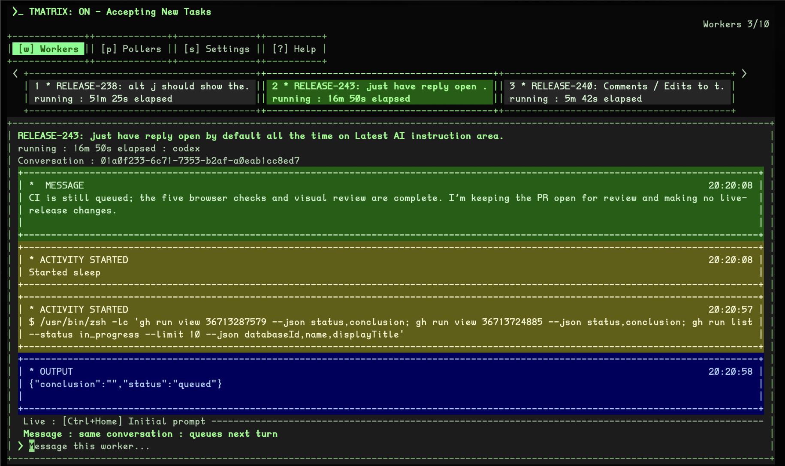

# TMatrix

Use your own AI subscriptions, computers and models to add AI powers to supported apps.

Save money since AI subscriptions are cheaper, your own computers are already paid for (vs expensive cloud servers).
Furthermore the models you pay for are possibly more powerful, and you already pay for them so may as well use them.

Concept:
- Your computer runs TMatrix app, this app, which is very easy to install/uninstall.
- TMatrix orchestraters tasks, pollers and workers.
- A **poller** gets tasks from a **source** like tzudo.app.
- An **AI worker** runs those tasks with Codex, Claude Code, or Gemini through Antigravity CLI.
- This goes on until the number of workers limit is reached. You can set the max # yourself.

---

Created for [Tzudo](https://tzudo.app/), the ultimate to do list and time tracker to 10x your productivity and work stress-free.



## Quick install

Mac, Linux, or Windows WSL:

```sh
curl -fsSL https://github.com/xmarkclx/tmatrix/releases/latest/download/install.sh | sh
```

- Open `tmatrix`, press `c`, and add TzuDo using your worker API key from https://tzudo.app/settings.

Press `s` to open Settings and view the TMatrix version, build number, and commit at the top.

## Route work across subscriptions

Sign Codex in to ChatGPT under the user that runs TMatrix. To add Claude, [install Claude Code](https://code.claude.com/docs/en/setup) 2.1.220 or newer and run `claude auth login` under that same user. In Claude's account settings, turn off **Usage credits** so Claude can report when its subscription is exhausted. TMatrix looks for `claude` on `PATH` and in `~/.local/bin`. Set `TMATRIX_CLAUDE_PATH` in the engine environment for a different location.

TMatrix runs each turn on the provider that owns the task's model ID. It never substitutes another model. A Codex model uses the Codex plan, then Codex credits when the plan is exhausted and credits are available. A Claude model runs on Claude Code and a Gemini model runs on Antigravity. Each uses its own account limits. If that provider is signed out or out of allowance, the turn fails with the reason. Any completed handoff is saved. [OpenAI credit billing](https://help.openai.com/en/articles/12642688-using-credits-for-flexible-usage-in-chatgpt-plus-pro)

TMatrix finds the provider from the start of the model ID:

| Model ID starts with | Provider |
| --- | --- |
| `gpt-`, `codex`, `o1` to `o4` | Codex |
| `claude-`, `sonnet`, `opus`, `haiku` | Claude Code |
| `gemini-` | Antigravity (`agy`) |

A task without a model, or with an ID that matches none of these, fails before any turn starts.

Open a worker to see which provider and allowance TMatrix selected. When a follow-up selects a model from another provider, TMatrix starts a conversation there with the task's saved handoff and the new input. The terminal shows Codex and Claude responses and tool activity.

TMatrix checks Anthropic's stable npm channel at startup and daily. Open **Settings**, press `o` for **Runtime updates**, and use Left or Right to choose a provider. TMatrix verifies each Claude Code release in its private runtime store before selecting it. Active workers keep the version they started with. Set `DISABLE_UPDATES=1` in the engine environment to turn off Claude update checks.

TMatrix reports included plan allowance and available paid balances to Tzu Do when it has one production Tzu Do source. It refreshes these figures at startup and every five minutes while the engine runs. Claude Code does not report a prepaid balance, so Tzu Do can show Claude's plan allowance and whether Usage credits are off.

To report to one account when several production sources are configured, set `TMATRIX_USAGE_SOURCE_ID` in the engine or service environment to that source's `id` in `config.json`. Use the same setting to opt in to reporting on official Tzu Do staging or a PR preview. Use `legacy` for a single-source legacy engine. A missing or invalid selection on a multi-account engine leaves reporting off.

## Select Gemini in Tzu Do

1. Run `agy models` as the user that runs TMatrix. Choose a `gemini-*` ID listed for that account, such as `gemini-4-neon-high`.
2. In Tzu Do, open **Settings → AI execution**. Enter the ID under **Model ID** for the task mode you use and select **Save AI settings**.
3. Queue a task in that mode. Its worker card shows the model. A follow-up in that mode resumes the saved Gemini conversation. Messages sent during a Gemini turn wait for the turn to finish.

The default TMatrix worker sends the exact ID to `agy` and uses its existing sign-in and tool permissions. For Neon, the model suffix selects the reasoning level. Run `agy models` again to discover new IDs. For a nonstandard installation, set `TMATRIX_AGY_PATH` to the absolute path of the executable.

The default worker runs any `gemini-*` model through `agy`. Gemini is also available as a dedicated worker with `"worker_type": "gemini"` in the TMatrix configuration. [Antigravity headless mode](https://antigravity.google/docs/cli/headless/)

Tzu Do’s **AI usage** indicator shows the lowest remaining percentage across the Gemini quota windows in `agy -p /usage` and the account credit balance from `agy -p /credits`. TMatrix refreshes both readings on its five-minute reporting schedule. You can check either command as the user that runs TMatrix.

## Watch and talk to Claude workers

Open a worker to follow it live: the activity log shows Claude's replies, each tool call with its input (commands, file paths, edits), a preview of each tool result, and todo updates. Press `Enter` to send a message into the running conversation; Claude handles it after its current step, in the same session. Each new Tzu Do comment resumes the task's Claude conversation, so context and the prompt cache carry over. If a follow-up moves the task to another provider's model, the worker says so in its reply.

To run interactive Claude Code in a private tmux session instead, set `TMATRIX_CLAUDE_TERMINAL=1` in the engine environment (Linux and macOS with `tmux`). The worker panel then mirrors Claude's screen: `v` switches to the activity log and `a` attaches (`Ctrl+B` then `D` returns). Workers answer only Claude Code's known startup dialogs; attach to answer anything else.

## Connect multiple sources

One TMatrix instance can poll several supported apps. Existing installations keep their saved connection, key, poller identity, and conversations when the settings upgrade.

1. Press `c` to add a source.
2. Enter a name, the complete HTTPS poll URL, and that source's worker API key.
3. Press `Ctrl+S` to save. TMatrix starts the new poller while existing workers continue. If intake is paused, the new source also waits for you to resume.

For Mindmap chat, use this complete poll URL and the dedicated key from **Settings → Integrations → Set up TMatrix**:

```text
https://mindmap.tzudo.app/api/ai-chat/worker/poll
```

One Mindmap connection serves your account's maps in that team, including LifeCCC. It uses a different key from the team graph API. Entering only a server domain selects the default TzuDo `/api/v1/ai/poll` endpoint.

Press `p` to inspect each source's status. Use Up and Down to select a source, `e` to edit it, or `d` to request removal and `y` to confirm. A blank key while editing reuses only the selected source's saved key. Adding a source always requires its own key. Editing or removing a source waits for active work before restarting. Removing the last source leaves the console disconnected.

The maximum worker count limits all sources together. Space pauses or resumes new intake across every source. Worker cards identify the source that owns each task. Source credentials stay in separate private files on this machine.

For offline conversation recovery, select the source ID shown in Pollers when several sources are configured:

```sh
tmatrix --source <source-id> conversation recover <canonical-task-id> --confirm-runtime-stopped
```

**Uninstalling** 
Removes the daemon and tmatrix command from path:

```sh
tmatrix service uninstall && rm -f "$HOME/.local/bin/tmatrix"
```

# Security Recommendations
- Best to run on its own secure environment like on a VM.
- Turn off / pause intake when not being used.


## Executing-worker security warnings

See [security warnings](docs/security-alerts.md) for the executing agent's advisory
action, private runtime integration, Tzu Do mail endpoint and delivery limits.

## Engine launch logs

The daemon rotates `engine-launch.log` at 10 MiB and keeps three backups.
See [engine launch logs](docs/launch-logs.md) for retention and upgrade behavior.
